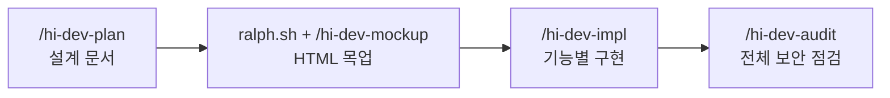

# Study Log Manager
비밀번호 하나로 보호되는 개인용 학습 노트 웹앱.

이 저장소는 앱 자체보다 **만든 과정을 보여 주기 위한 저장소**입니다. 마크다운 파일 하나에 적던 빅데이터분석기사 실기 노트를 앱으로 옮기면서, 설계부터 구현까지를 Claude Code 스킬과 서브에이전트, 랄프 루프로 구성한 파이프라인에 맡겼습니다. 스킬, 에이전트 정의, 스크립트, 각 단계의 기록을 모두 함께 공개합니다.

## 파이프라인

| 단계 | 하는 일 | 입력 | 출력 |
| --- | --- | --- | --- |
| [hi-dev-plan](.claude/skills/hi-dev-plan/SKILL.md) | 요구사항을 조사해 기능, 화면, API 약속을 문서로 고정한다 | 사용자의 설명과 기존 노트 | [docs/design.md](docs/design.md) |
| [hi-dev-mockup](.claude/skills/hi-dev-mockup/SKILL.md) | 설계대로 동작하는 HTML 목업을 한 걸음씩 만든다 | 설계 문서 | [mockup/index.html](mockup/index.html) |
| [hi-dev-impl](.claude/skills/hi-dev-impl/SKILL.md) | 지휘자가 서브에이전트에게 일을 나눠 기능을 끝까지 완성한다 | 설계 문서, 목업 | `src/`, `tests/`, [실행 보고서](docs/impl-reports/) |
| [hi-dev-audit](.claude/skills/hi-dev-audit/SKILL.md) | 전체 코드를 보안 관점으로 점검하고 수정 항목을 등록한다 | 코드 전체 | [감사 보고서](docs/audit-reports/2026-11-01.md), [재확인](docs/audit-reports/2026-11-01-recheck.md) |

단계 사이의 약속은 문서입니다. 각 단계는 앞 단계의 파일만 읽으므로 대화 기록이 없어도 이어서 진행할 수 있습니다.

### 랄프 루프 (목업 단계)
[ralph.sh](.claude/skills/hi-dev-mockup/scripts/ralph.sh)는 같은 스킬을 매번 새 세션으로 반복 실행합니다. 세션은 이전 대화를 모르고, 기억은 [진행 기록 파일](docs/mockup-progress.md)에만 남습니다. 한 회차는 화면이나 기능 하나만 진행하고 회차마다 커밋합니다.

완료 판단은 Claude의 말이 아니라 스크립트가 합니다. 진행 기록의 마지막 줄이 정확히 `STATUS: DONE`이고, 체크되지 않은 항목이 없고, ID 검사를 통과해야 끝납니다. 이 조건은 실패에서 나왔습니다. 처음 스크립트는 메모에 적힌 `STATUS: DONE` 글자를 완료로 오인해 일찍 멈췄고, 브라우저로 직접 눌러 보고서야 공부 기록 저장 버그가 남아 있다는 것을 알았습니다.

### 지휘자와 서브에이전트 (구현 단계)
구현 단계의 메인 세션은 코드를 쓰지 않는 지휘자입니다. [에이전트 정의](.claude/agents/)대로 일을 나눠 맡기고 결과를 판정합니다.

| 에이전트 | 맡은 일 | 고칠 수 있는 곳 | 모델 |
| --- | --- | --- | --- |
| implementer | 구현, 버그 수정 | `src/` | Sonnet |
| test-writer | 완료 기준으로 테스트 작성. 구현 코드는 보지 않는다 | `tests/` | Sonnet |
| tester | 테스트 실행, 실패를 코드, 테스트, 설계 문제로 분류 | 없음 | Sonnet |
| reviewer | 코드 리뷰 | 없음 | Opus |
| qa | 코드를 보지 않고 HTTP로만 검증 | 없음 | Sonnet |
| security | 보안 점검 | 없음 | Opus |
| doc-keeper | 문서 갱신, 기능 커밋 | `README.md`, `docs/service/` | Haiku |

구현과 테스트는 서로의 코드를 보지 않고 설계 문서의 약속만 보고 동시에 작성합니다. blocker와 major 지적이 없어질 때까지 테스트와 리뷰를 반복하고, 정해진 횟수를 넘기면 멈춰서 사람에게 보고합니다.

## 결과
스킬 하나를 실행해 기능 6개와 시드 스크립트를 끝까지 구현했습니다. 스킬의 기본은 한 번에 기능 하나지만, 이번에는 사용자 지시로 한 대화에서 이어서 진행했습니다.

| 항목 | 값 |
| --- | --- |
| 자동 테스트 | 1,159개 |
| 앱 코드 | 약 3,300줄 (외부 라이브러리 제외) |
| 테스트 코드 | 약 8,000줄 |

| 기능 | 테스트 루프 | 리뷰 수정 라운드 | 보고서 |
| --- | --- | --- | --- |
| F5 비밀번호 로그인 | 0 | 1 | [F5](docs/impl-reports/F5.md) |
| F1 학습 주제 관리 | 0 | 0 | [F1](docs/impl-reports/F1.md) |
| F2 공부 시간 기록 | 0 | 0 | [F2](docs/impl-reports/F2.md) |
| F3 노트 작성·보기·수정·삭제 | 0 | 2 | [F3](docs/impl-reports/F3.md) |
| F4 노트 검색·필터 | 2 | 1 | [F4](docs/impl-reports/F4.md) |
| F6 마크다운 내보내기 | 0 | 0 | [F6](docs/impl-reports/F6.md) |
| 시드 스크립트 | 0 | 0 | [SEED](docs/impl-reports/SEED.md) |
| 보안 감사 수정 | 2 | 3 | [SEC](docs/impl-reports/SEC.md) |

구현 뒤 테스트와 리뷰에서 잡힌 문제의 예입니다.
- 동시에 보낸 로그인 요청이 5회 제한을 넘을 수 있는 경쟁 조건
- 특정 유니코드 입력이 든 태그가 저장되면 그 노트를 다시 열 수 없는 문제
- 아주 긴 검색어나 많은 태그 조건에서 오류 형식이 약속과 달라지는 문제
- 약 7% 확률로 실패하던 변조 쿠키 테스트

### 한계
- 공개 배포는 하지 않았습니다. 공개할 때 따를 절차는 [실행과 백업](docs/service/running.md)에 있습니다.
- 실제 프록시 환경의 동작은 배포 위치가 정해진 뒤 확인해야 합니다.
- 작은 지적은 수정하지 않고 각 보고서에 남겼습니다.

## 파이프라인 써 보기
`.claude/` 폴더를 새 프로젝트에 복사한 뒤 차례로 실행합니다. [Claude Code](https://claude.com/claude-code)가 필요합니다.

1. `/hi-dev-plan`으로 설계 문서를 만듭니다.
2. `bash .claude/skills/hi-dev-mockup/scripts/ralph.sh`로 목업을 만듭니다.
3. 새 대화에서 `/hi-dev-impl`을 기능마다 실행합니다.
4. `/hi-dev-audit`으로 전체를 점검합니다.

## 실행 방법
- 설치: `python3.12 -m venv .venv && source .venv/bin/activate && pip install -r requirements.txt` (그 뒤 `cp .env.example .env`로 설정, 자세한 내용은 [실행과 백업](docs/service/running.md))
- 서버 실행: `uvicorn app.main:app --app-dir src --reload --port 8000`
- 테스트: `pytest tests/`

## 주요 기능
- F1 학습 주제 관리
- F2 공부 시간 기록
- F3 노트 작성·보기·수정·삭제
- F4 노트 검색·필터
- F5 비밀번호 로그인
- F6 마크다운 내보내기
- F7 렌더 실패 복구
- F11 화면 공통 오류 처리
- 초기 데이터 시드 스크립트

## 문서
- [기능 현황](docs/service/features.md)
- [API](docs/service/api.md)
- [실행과 백업](docs/service/running.md)
- [구현 전체 정리](docs/impl-reports/SUMMARY.md)
- [설계 문서](docs/design.md)

## 라이선스
[MIT](LICENSE). `src/app/static/vendor/`의 라이브러리는 각자의 라이선스를 따릅니다.
